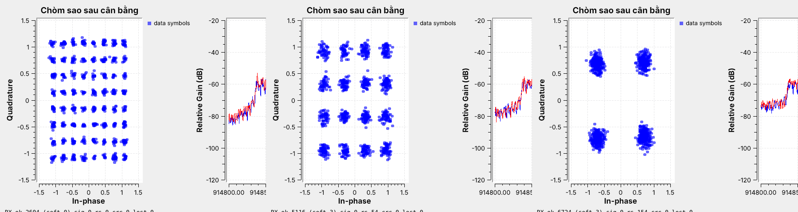

# Điều chế thích ứng (ACM), v0.3

Từ v0.3, máy phát tự chọn điều chế cho **từng khung** (BPSK, QPSK, 16QAM hoặc 64QAM) dựa trên SNR mà máy thu
báo ngược về. Cách làm giống ACM của DVB-S2: kênh tốt thì tăng tốc độ, kênh xấu thì hạ xuống điều chế bền hơn
thay vì mất khung. Bật bằng `--acm` ở **cả hai** máy.



## 1. Nguyên lý

```
TX: hàng đợi gói ─► chọn điều chế m (AcmController) ─► khung ACM: k(m) codeword ─► OFDM 2x2 ─► RF
                         ▲                                                             │
                         │ UDP 5003, 10 lần/s: {SNR_eff, tỉ lệ codeword lỗi, m đang thu}│
RX: ◄────────────────────┴──── FeedbackSender ◄── SNR_eff từng khung (sau cân bằng) ◄──┘
```

**Khung ACM có độ dài cố định:** 4 symbol mào đầu + 42 symbol dữ liệu + khe 80 mẫu = 3760 mẫu. Mỗi khung chứa
số codeword RS(248,216) tùy theo điều chế:

| Điều chế | Codeword/khung (siso, simo, alamouti) | smux | TS sau RS8+8 ở 1 MS/s (alamouti) | Ngưỡng SNR_eff (CER ≤ 1%) |
|---|---|---|---|---|
| BPSK | 1 | 2 | 200 kb/s | 9 dB |
| QPSK | 2 | 4 | 400 kb/s | 14 dB |
| 16QAM | 4 | 8 | 800 kb/s | 20 dB |
| 64QAM | 6 | 12 | 1200 kb/s | 26 dB |

Vì độ dài khung không đổi, phần đồng bộ của máy thu giữ nguyên; máy thu chỉ đọc điều chế trong SIG rồi giải điều chế theo đó.

**SIG của khung ACM** chứa 24 bit (byte chế độ/điều chế có cờ ACM, 8 bit số thứ tự, CRC8). 24 bit này được phát
**hai lần** trên hai nửa dải, cách nhau 24 sóng mang con. Máy thu cộng mềm hai bản, được lợi khoảng 3 dB cộng phân tập
tần số, nên SIG không còn là khâu yếu nhất khi kênh xấu.

**SNR_eff** là SNR sau cân bằng, lấy trung bình điều hòa trên các sóng mang con và luồng, đúng đại lượng đã dùng
làm trọng số giải mềm. Nhờ vậy nó đã tính đến phân tập MIMO và fading chọn lọc tần số. Máy thu lọc thêm
(EWMA 0,8/0,2) trước khi gửi.

**Bộ điều khiển (máy phát):**

- **Hạ ngay** khi SNR_eff < ngưỡng + `--acm-margin` (mặc định 1 dB), hoặc khi tỉ lệ codeword lỗi > 10%. Tỉ lệ lỗi
  chỉ được tính sau khi máy thu đã báo là đang nhận đúng điều chế mới, vì các khung còn trên đường truyền là điều chế cũ.
- **Tăng từng bậc** khi SNR_eff ≥ ngưỡng bậc trên + margin + 1 dB (trễ), giữ liên tục 0,5 s.
- **Mất phản hồi quá 1,5 s** thì về điều chế bền nhất.
- Đo **độ trễ vòng** (từ lúc đổi điều chế đến khi máy thu xác nhận) và ghi vào log cùng `report.json`.

Ngưỡng ở bảng trên lấy từ `tools/acm_calibrate.py`: kênh 2×2 Rayleigh ngẫu nhiên có tiếng vọng, giải mềm bật.
Muốn hiệu chỉnh lại cho phần cứng thật thì sửa `THRESHOLDS_DB` trong `ofdm321/acm.py`.

## 2. Chạy mô phỏng (một PC, không cần radio)

```bash
# Terminal 1, folder RX:
bash scripts/sim_rx_acm.sh --gui          # SNR đổi theo bậc 30/22/14/11/20/28 dB, mỗi bậc 6 s
# Terminal 2, folder TX, sau khi RX in "RX listening":
bash scripts/sim_tx_acm.sh
```

- Log TX in điều chế đang dùng, SNR_eff máy thu báo về, số lần chuyển và độ trễ vòng.
- Log RX có thêm `ACM <điều chế> SNR_eff <dB> (sim SNR <dB>)`.
- Cửa sổ `--gui` cho thấy chòm sao đổi giữa 64QAM, 16QAM, QPSK và BPSK.

Các tùy chọn mô phỏng khác:

- `--snr-profile sine:8:30:40`: SNR dao động hình sin từ 8 đến 30 dB, chu kỳ 40 s.
- `--snr-profile ramp:30:6:60`: SNR giảm dần từ 30 xuống 6 dB trong 60 s.
- `--fb-delay 0.5`: thêm 0,5 s trễ cho kênh phản hồi, giả lập vệ tinh địa tĩnh (GEO).

Nếu độ trễ vòng trong log TX tăng dần lên hàng giây, máy không xử lý kịp thời gian thực (mẫu dồn ứ trong ZeroMQ).
Khi đó thêm `--rate 400e3` ở **cả hai** bên.

## 3. Chạy thật với hai N321

```bash
# Máy thu (folder RX). acm-host là IP của PC chạy máy phát (cùng PC thì bỏ qua):
bash scripts/start_rx.sh --acm --acm-host 192.168.1.20 --play --gui
# Máy phát (folder TX):
bash scripts/start_tx.sh --acm --source file --input ~/Videos/clip.mp4 --seconds 120
# Thử ACM bằng cách đổi gain phát theo thời gian (không bao giờ vượt --tx-gain):
bash scripts/start_tx.sh --acm --tx-gain 25 --tx-gain-profile steps:25,15,5,15,25:10
```

- PC phát phải mở cổng UDP 5003 (`sudo ufw allow 5003/udp` nếu có bật tường lửa). Đổi cổng bằng `--acm-port` ở cả hai bên.
- Hai bên vẫn phải cùng `--mimo`, `--freq`, `--rate`. `--mod` không còn tác dụng khi bật `--acm`.
- Chỉ dùng một số điều chế: `--acm-modcods qpsk,16qam,64qam` (bên TX).
- **Video:** bộ mã hóa vẫn chạy bitrate cố định (`ts_muxrate` 260 kb/s). Dung lượng của BPSK ở 1 MS/s chỉ khoảng
  200 kb/s, nên khi ACM xuống BPSK hàng đợi phát sẽ đầy và video bị trễ dần. Muốn video luôn mượt thì chọn một trong hai:
  - giảm `video_bitrate`/`ts_muxrate` trong `config/default.json` của folder TX xuống khoảng 150 kb/s;
  - bỏ BPSK: `--acm-modcods qpsk,16qam,64qam`.

  Đổi bitrate video theo ACM là bước nâng cấp tiếp theo.

### Không có mạng chung giữa hai PC?

Từ v0.4, phản hồi có thể đi luôn qua sóng radio, bằng kênh B của hai N321. Cách này cần chạy `--mimo siso`.
Xem [PHAN_HOI_RADIO.md](PHAN_HOI_RADIO.md).

## 4. Kết quả mô phỏng (alamouti, Rayleigh, CFO 2 kHz, SFO 5 ppm, SNR 30/22/14/11/20/28 dB)

| Cấu hình | Gói DATA mất (trước RS8+8 bù) | Dung lượng trung bình |
|---|---|---|
| ACM, phản hồi tức thời (độ trễ vòng ≈ 0,1 s) | 80 / 6219 (1,3%), chỉ ở các lần SNR tụt đột ngột 8 dB | 3,4 codeword/khung (+71% so với QPSK cố định) |
| ACM, phản hồi trễ 0,5 s (giả lập GEO) | 371 / 6219 (6%) | tương tự |
| 16QAM cố định | 2936 / 6219 (47%), mất ở các bậc 14 và 11 dB | 4 codeword/khung khi còn sống |
| QPSK cố định | 0 | 2 codeword/khung |

Các lượt ACM chạy ở 400 kS/s vì máy kiểm thử chỉ có 2 nhân, không giữ được thời gian thực ở 1 MS/s với cả TX, RX
và bộ mô phỏng kênh. Các lượt cố định chạy ở 1 MS/s; tỉ lệ mất không phụ thuộc tốc độ lấy mẫu.

Nhận xét:

- ACM giữ được liên kết ở SNR thấp như QPSK và tận dụng kênh tốt gần bằng 64QAM.
- Gói mất chỉ xảy ra trong khoảng một vòng phản hồi sau mỗi lần SNR tụt mạnh. Trễ phản hồi càng lớn (vệ tinh) thì
  mất càng nhiều. Cách bù: tăng `--acm-margin` hoặc dựa thêm vào RS8+8 ngoài.
- Khi viết ACM, đã phát hiện và sửa một lỗi của bộ mô phỏng lệch clock: nội suy tuyến tính làm suy giảm các sóng
  mang con ở mép dải tới khoảng 11 dB. Nay đã thay bằng bộ nội suy windowed-sinc 16 tap.

## 5. File liên quan

| File | Nội dung |
|---|---|
| `ofdm321/acm.py` | `AcmController`, `FeedbackSender` (RX), `FeedbackReceiver` (TX), bảng ngưỡng |
| `ofdm321/modem.py` | Khung ACM (`NP_ACM`, `codewords_per_frame`), SIG lặp, BPSK/64QAM, SNR_eff |
| `ofdm321/blocks.py` | `MimoTxSource(acm=...)`, `MimoRxSink` đếm theo codeword, `parse_snr_profile` |
| `tools/acm_calibrate.py` | Đo CER theo SNR_eff để đặt ngưỡng |
| `tests/test_modem.py` | `test_acm_frames_any_modulation`, `test_acm_controller` |
