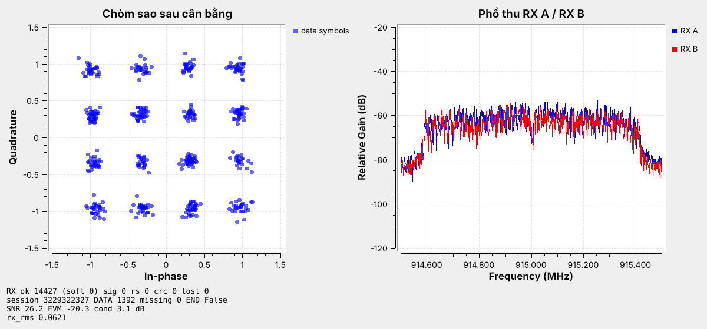

# Hướng dẫn chạy video OFDM 2×2 MIMO giữa hai USRP N321

| Folder | Máy | Anten | Việc |
|---|---|---|---|
| `OFDM_N321_TX` | N321 **#1** (phát) | 2 anten trên **TX/RX** của kênh A và kênh B | FFmpeg → đóng gói + FEC → OFDM MIMO → phát |
| `OFDM_N321_RX` | N321 **#2** (thu) | 2 anten trên **RX2** của kênh A và kênh B | thu → đồng bộ, ước lượng kênh 2×2 → giải mã → video |

Hai folder dùng chung code `ofdm321` (giống bản loopback `OFDM_N321_MIMO`). Mỗi bên chỉ mở radio
của mình. Hai N321 chạy clock riêng, nên bộ thu tự bù lệch tần số (CFO) và lệch tốc độ lấy mẫu.
Đã thử bằng mô phỏng đến CFO ±5 kHz và lệch clock ±10 ppm.

## 1. Chọn cách nối mạng

**Cách A: một PC, hai N321 qua switch gigabit** (đơn giản nhất)

```
PC enp1s0 (192.168.180.1) ── switch 1G ──┬── SFP0 N321 #1 (TX) 192.168.180.3
                                          └── SFP0 N321 #2 (RX) 192.168.180.4
```

- Hai N321 **bắt buộc khác IP**. Nếu cả hai đều đang là 192.168.180.3, đổi IP của máy thứ hai
  **trước khi** cắm cả hai vào switch (xem mục 2).
- Băng thông tổng khoảng 16 MB/s, cổng 1 GbE dư sức. Với CPU máy này thì chạy TX và RX cùng lúc
  vẫn kịp (đo được dư khoảng 3,7 lần).

**Cách B: hai PC, mỗi PC một N321**

- PC phát dùng folder TX, PC thu dùng folder RX. Mỗi PC cài theo mục 3.
- Hai N321 có thể cùng IP vì nằm trên hai mạng riêng. Khi đó chạy RX với `--args addr=192.168.180.3,master_clock_rate=200e6`.

**Cách C: một PC chỉ có một cổng mạng, không có switch.** N321 #1 tự phát lại file IQ do PC tính sẵn, cổng mạng
duy nhất của PC nối với N321 #2. Xem [MOT_CONG_MANG.md](MOT_CONG_MANG.md).

## 2. Đổi IP SFP0 của N321 thứ hai (chỉ cần cho cách A)

Chỉ cắm **riêng** N321 #2 vào PC, rồi SSH vào (mặc định user `root`, không mật khẩu):

```bash
ssh root@192.168.180.3
cat /etc/systemd/network/sfp0.network        # tìm dòng Address=192.168.180.3/24
sed -i 's#^Address=.*#Address=192.168.180.4/24#' /etc/systemd/network/sfp0.network
reboot
```

Nếu SSH không vào được thì dùng console USB: `sudo screen /dev/ttyUSB2 115200`, đăng nhập `root`, sửa
cùng file đó.

Sau khi N321 #2 khởi động lại, cắm cả hai vào switch rồi kiểm tra:

```bash
ping -c 2 192.168.180.3 ; ping -c 2 192.168.180.4 ; uhd_find_devices
```

Phải thấy **2 thiết bị** với 2 serial khác nhau.

## 3. Cài đặt (mỗi PC làm một lần)

```bash
bash scripts/setup_ubuntu.sh                             # GNU Radio, UHD 4.6, FFmpeg
sudo bash scripts/setup_network_10g.sh enp1s0 192.168.180.1/24
python3 tools/probe_n321.py --addr 192.168.180.3 --stream   # folder TX
python3 tools/probe_n321.py --addr 192.168.180.4 --stream   # folder RX (cách A)
python3 tests/test_modem.py
```

Probe phải báo `probe_ok: true` và không có cảnh báo overrun.

`device_args` mặc định đã đặt sẵn:

- TX: `config/default.json` dùng `addr=192.168.180.3`;
- RX: `config/default.json` dùng `addr=192.168.180.4`.

Muốn khác thì sửa file config hoặc thêm `--args ...` khi chạy.

## 4. Chạy thử không cần radio (một PC, hai terminal)

```bash
# Terminal 1 (folder RX):
bash scripts/sim_rx.sh --play
# Terminal 2 (folder TX), sau khi RX đã in "RX listening":
bash scripts/sim_tx.sh
```

Mẫu IQ đi qua ZeroMQ (`tcp://127.0.0.1:5560`). Phía RX giả lập đủ các sai lệch của hai radio thật:
lệch clock 5 ppm, kênh 2×2 Rayleigh, SNR 20 dB, CFO 2 kHz. Kết quả đúng: RX in `SIM_RX_VERIFIED`, và sha256
của RX trùng với sha256 TX in ra.

## 5. Chạy thật với hai N321

1. **Anten.** N321 #1: hai anten 915 MHz trên TX/RX A và TX/RX B. N321 #2: hai anten trên RX2 A và RX2 B.
   - Hai anten trên cùng một máy đặt cách nhau **≥ 16 cm** (nửa bước sóng ở 915 MHz).
   - Hai máy đặt cách nhau 1–3 m khi thử lần đầu.
   - Chỉ phát ở băng tần được phép. Ở Việt Nam nên dùng khoảng 920–923 MHz, ví dụ thêm `--freq 921e6` ở **cả hai** phía.
2. **RX chạy trước** (folder RX):
   ```bash
   bash scripts/start_rx.sh --play
   ```
   Đợi đến khi thấy dòng `RX listening`.
   Muốn xem **chòm sao và phổ** trong lúc thu, thêm `--gui` (cần màn hình desktop):
   ```bash
   bash scripts/start_rx.sh --play --gui
   ```
   Đóng cửa sổ hoặc Ctrl+C thì RX dừng và vẫn ghi report như bình thường.
3. **TX chạy sau** (folder TX):
   ```bash
   bash scripts/start_tx.sh                                               # testpattern 30 s
   bash scripts/start_tx.sh --source file --input ~/Videos/clip.mp4 --seconds 60
   bash scripts/start_tx.sh --source webcam --input /dev/video0
   ```
   TX phát 5 giây khung IDLE để RX khóa trước, sau đó mới phát video. Kết thúc, TX in `TX_COMPLETE`, session và sha256.
4. RX tự dừng khoảng 3 giây sau khi nhận END. Thành công khi in `RF_RX_VERIFIED`. So sánh với TX:
   ```bash
   # cách A (cùng PC):
   python3 tools/compare_tx_rx.py ~/Desktop/OFDM_N321_TX/runs/<lượt TX>/report.json
   # cách B: copy report.json của PC phát sang PC thu rồi chạy lệnh tương tự
   ```

**Hai bên phải dùng cùng** `--mimo`, `--mod`, `--rate` và `--freq`. Nếu khác nhau, RX sẽ báo nhiều `sig` (SIG sai)
và không nhận được khung nào.

## 6. Đọc log RX

```
RX ok 9645 sig 1 rs 0 crc 0 lost 0 | session 859074745 DATA 2591 missing 0 END True | SNR 18.2 EVM -16.8 cond 6.5 dB | rx_rms 0.0645
```

| Trường | Ý nghĩa | Nên thấy |
|---|---|---|
| `ok` | khung giải đúng (cả IDLE) | tăng khoảng 481 khung/s ở alamouti QPSK 1 MS/s |
| `sig` / `rs` / `crc` | khung bị loại ở từng bước kiểm tra | nhỏ; outer RS8+8 vẫn bù được |
| `lost` | số lần mất khóa khung | 0 hoặc rất ít |
| `session` | session của TX mà RX đã bám | trùng số TX in ra |
| `SNR` / `EVM` | chất lượng kênh | QPSK: EVM < −12 dB; 16QAM: < −20 dB |
| `cond` | độ khả nghịch của ma trận kênh H (dB) | smux cần dưới khoảng 10–15 dB |
| `rx_rms` | biên độ thu | khoảng 0,005–0,2; lớn hơn 0,5 là sắp bão hòa → giảm `--rx-gain` |

### Đọc cửa sổ `--gui`



- **Trái: chòm sao sau cân bằng.** Ký hiệu dữ liệu của 1 khung tốt mỗi 8 khung, sau MRC / SFBC / MMSE
  và bù pha bằng pilot, trước khi quyết định bit. QPSK có 4 đám tại (±0,71, ±0,71); 16QAM có 16 đám tại
  ±0,32 / ±0,95. Với smux, hai luồng vẽ chung.
- **Phải: phổ thu** RX A (xanh) và RX B (đỏ). Dải OFDM rộng khoảng ±406 kHz quanh tần số trung tâm.
- **Dưới: dòng trạng thái**, giống log RX.

| Chòm sao trông như | Nghĩa là | Làm gì |
|---|---|---|
| Đám nhỏ, tròn, tách rõ | kênh tốt (EVM < −20 dB) | có thể thử `16qam` hoặc `smux` |
| Đám to, sát nhau | SNR thấp | đưa máy lại gần, tăng gain, dùng `alamouti` |
| Đám kéo thành vệt cung tròn | pha còn trôi (CFO/SFO lớn, kênh thay đổi nhanh) | thử `--sync gpsdo` ở cả hai bên, giữ yên anten |
| Một số điểm văng xa | nhiễu xung hoặc sóng mang con bị fading sâu | interleaver + giải mềm thường vẫn sửa được; xem `rs` |
| Trống, không cập nhật | chưa có khung nào giải đúng | xem mục "ok đứng yên" bên dưới |
| Phổ có dải OFDM nhưng ok = 0 | khác `--mimo/--mod/--freq` giữa hai máy | kiểm tra lại tham số hai bên |

Mỗi lần chạy, ảnh chòm sao cuối cùng được lưu dạng số trong `runs/<lượt>/const_last.npy`
(`numpy.load(...)` để vẽ lại). `--const-every N` đổi tần suất lấy mẫu chòm sao (0 = tắt).

Xử lý khi gặp vấn đề:

- **`ok` đứng yên ở 0:** kiểm tra hai bên cùng tần số và cùng chế độ, anten cắm đúng cổng (TX/RX bên phát,
  RX2 bên thu), rồi tăng `--tx-gain` (bên TX, tối đa 30 khi dùng anten) hoặc `--rx-gain` (bên RX).
- **SNR thấp hoặc `rs` nhiều:** đưa hai máy lại gần, tăng gain, dùng `alamouti` thay vì `smux`.
- **`lost` tăng đều:** lệch clock quá lớn hoặc tín hiệu chập chờn. Có thể khóa cả hai N321 vào GPS
  (máy có GPSDO): cắm anten GPS và chạy cả hai bên với `--sync gpsdo`, khi đó CFO gần như bằng 0.
  Cần nhìn được bầu trời; trong nhà thì dùng `internal`.

## 7. Thử các chế độ

| Lệnh (thêm vào **cả hai** bên) | Ghi chú |
|---|---|
| `--mimo siso` | so sánh: chỉ anten TX A và RX A |
| `--mimo simo` | 1 TX, 2 RX (MRC) |
| `--mimo alamouti` (mặc định) | 2×2 phân tập, chắc chắn nhất |
| `--mimo alamouti --mod 16qam` | dung lượng 588 kb/s, cần EVM < −20 dB |
| `--mimo smux` | 2 luồng, 588 kb/s với QPSK, cần `cond` thấp |

Muốn tăng bitrate video, sửa `video_bitrate` / `ts_muxrate` trong `config/default.json` của folder **TX**.
Nên giữ dưới khoảng 85% dung lượng của chế độ đang dùng: alamouti QPSK 362 kb/s, 16QAM hoặc smux 588 kb/s.

### Điều chế thích ứng (v0.3)

Thêm `--acm` ở **cả hai** bên. Khi đó máy phát tự chọn BPSK, QPSK, 16QAM hoặc 64QAM theo SNR máy thu báo về
qua UDP 5003. Hai PC khác nhau thì thêm `--acm-host <IP PC phát>` bên RX. Chi tiết, mô phỏng và kết quả: [ACM.md](ACM.md).

## 8. Đã kiểm chứng

- Mô phỏng hai tiến trình qua ZeroMQ trên GNU Radio 3.10.9, video thu trùng sha256 với video phát, không thiếu DATA:
  - alamouti QPSK, kênh Rayleigh 20 dB, CFO 2 kHz, lệch clock 5 ppm;
  - smux QPSK, kênh cố định 25 dB, CFO 5 kHz, lệch clock 10 ppm;
  - siso QPSK, CFO −4 kHz, lệch clock −8 ppm.
- Loopback trên một N321 thật (`OFDM_N321_MIMO`, anten, alamouti) đã PASS ngày 16/11.
- **Chạy thật giữa hai N321 thì chưa thử.** Đây là bước tiếp theo của bạn.
